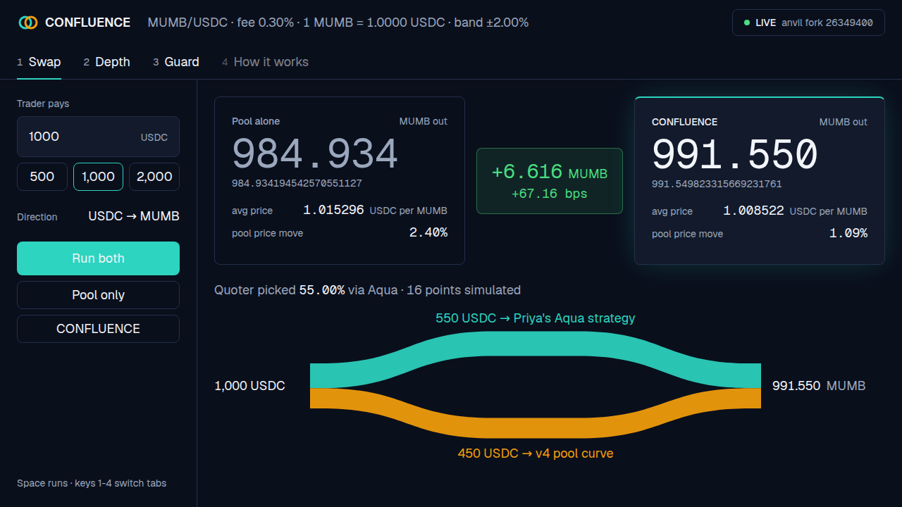

# CONFLUENCE

**Live site: https://confluence-delta-seven.vercel.app/**

*A v4 pool with almost no locked liquidity that trades deep, because its depth sits in makers' own wallets via Aqua.*

The hosted site is a replay of runs recorded from the mainnet fork; the live demo runs on the local fork (see [Run it](#5-run-it)).



Built at ETHGlobal Mumbai (Nov 5-7, 2026), Classic track, team of two. Prizes: Uniswap "Build with Uniswap" and 1inch "Build an Aqua App". Demo video: see [docs/demo-video-link.md](docs/demo-video-link.md).

---

## 1. The pitch and the problem

CONFLUENCE is a Uniswap v4 hook whose pool depth comes from a maker's 1inch Aqua strategy, not from locked liquidity. A new token's pool starts thin, and the usual fix is for a market maker to lock inventory in that one pool, where it can serve nothing else. Here the maker's tokens stay in her own wallet until the moment of a fill, and the hook buys part of each swap from her strategy inside the same transaction while the pool curve fills the rest.

The two sides of the pitch, one per sponsor:

- **Uniswap:** "A v4 pool with almost no locked liquidity that trades deep, because its depth sits in makers' own wallets via Aqua."
- **1inch:** "A SwapVM Extruction module, running on 1inch's own deployed router, pins Aqua fills to the pool's live price. Any maker can plug it into any strategy with no redeploy."

What we measured (on the fork at block 26,349,400, 1,000 USDC into MUMB, from `pnpm --dir scripts run demo`): the pool alone returns **984.934194542570551127 MUMB**; with CONFLUENCE the same trade returns **991.549823315669231761 MUMB** (+6.615628773098680634 MUMB, +67.16 bps), 550 USDC filled by Aqua and 450 USDC by the pool, and the pool's price moves 1.09% instead of 2.40%. These numbers hold for this setup only (Priya's 0.30% fee equals the pool's, 100,000 of each token shipped, a 2,500 USDC / 2,500 MUMB seed). They are not a general claim ([D-22](docs/DECISIONS.md)).

## 2. How it works

Cast: **Priya** (the maker) holds MUMB, our mock long-tail token, and ships a SwapVM strategy to Aqua. The **trader** swaps through the v4 pool. Inside the hook, the hook itself is Aqua's taker.

One exact-input swap:

1. The trader swaps through the v4 pool; the PoolManager calls our hook's `beforeSwap`.
2. The hook picks the Aqua slice: from the hint in `hookData` (phase 1, chosen off-chain by the quoter).
3. The hook takes that much input token out of the PoolManager.
4. The hook calls 1inch's deployed `AquaSwapVMRouter` `swap` as taker with `useTransferFromAndAquaPush`. Priya's program runs; its Extruction step calls our `PoolPriceBandExtruction`, which reverts if the fill is outside the band around the pool's live price. Aqua pulls MUMB from Priya to the hook and the router collects the hook's input into Priya's strategy.
5. The hook settles the MUMB into the PoolManager and returns a `BeforeSwapDelta` for what it served.
6. The pool curve fills the rest; the PoolManager checks every balance nets to zero or reverts everything.

```
 trader ──swap(hookData = hint)──▶ PoolManager ──beforeSwap──▶ ConfluenceHook
                                        ▲                          │ 3. take(input, a)
                                        │                          │ 4. router.swap(order, a)   [try/catch]
                                        │                          ▼
                                        │            AquaSwapVMRouter (official, unmodified)
                                        │              runs Priya's program:
                                        │              fee ▶ XYC curve ▶ Extruction ──▶ PoolPriceBandExtruction
                                        │                                               reverts if fill is
                                        │                                               outside ±bandBps of
                                        │                                               the pool's live price
                                        │              Aqua pulls b MUMB from Priya's wallet ──▶ hook
                                        │                          │
                                        │ 5. settle(MUMB, b)       │
                                        └───── BeforeSwapDelta(+a, −b) ◀── hook
                                        │
                              6. pool curve fills the other (amount − a) against the seed position;
                                 PoolManager reverts unless every balance nets to zero
```

If step 4 fails for any reason (band breached, strategy docked, Priya's wallet short, approval revoked, out of gas), everything the router did is undone with it. The hook returns the input it took, emits `AquaSkipped(poolId, reason)` with the router's revert data and returns a zero delta, so the pool fills the whole swap. **Aqua can never make a v4 swap fail** ([D-20](docs/DECISIONS.md)). Full detail, including the token-flow invariants, is in [docs/ARCHITECTURE.md](docs/ARCHITECTURE.md).

## 3. Uniswap integration

All links are pinned to commit [`f706768`](https://github.com/Adityaraj-web/confluence/tree/f706768612324a1ea83ee404d349cb46f2171fa1), so the line ranges below cannot drift.

| What | Where |
| --- | --- |
| The hook's `beforeSwap`: hint decoding, every skip check, the call into Aqua, the event | [`ConfluenceHook.sol` L177-L213](https://github.com/Adityaraj-web/confluence/blob/f706768612324a1ea83ee404d349cb46f2171fa1/contracts/src/ConfluenceHook.sol#L177-L213) |
| Take from the PoolManager, the router call in `try`/`catch`, settle the output (or settle the input back on failure) | [`ConfluenceHook.sol` L237-L271](https://github.com/Adityaraj-web/confluence/blob/f706768612324a1ea83ee404d349cb46f2171fa1/contracts/src/ConfluenceHook.sol#L237-L271) (`take` at L245, `settle` at L269-L270) |
| The `BeforeSwapDelta` return: `toBeforeSwapDelta(+a, -b)` for exact input | [`ConfluenceHook.sol` L211-L212](https://github.com/Adityaraj-web/confluence/blob/f706768612324a1ea83ee404d349cb46f2171fa1/contracts/src/ConfluenceHook.sol#L211-L212) |
| Hook permissions (`beforeSwap` and `beforeSwapReturnDelta` only) and the address check | [`ConfluenceHook.sol` L122-L132](https://github.com/Adityaraj-web/confluence/blob/f706768612324a1ea83ee404d349cb46f2171fa1/contracts/src/ConfluenceHook.sol#L122-L132) |
| Maker registers her order for a pool | [`ConfluenceHook.sol` L137-L145](https://github.com/Adityaraj-web/confluence/blob/f706768612324a1ea83ee404d349cb46f2171fa1/contracts/src/ConfluenceHook.sol#L137-L145) |
| Pool setup script: mine the hook address (CREATE2, exact flag bits) | [`Setup.s.sol` L131-L140](https://github.com/Adityaraj-web/confluence/blob/f706768612324a1ea83ee404d349cb46f2171fa1/contracts/script/Setup.s.sol#L131-L140) |
| Pool setup script: initialise the pool at the anchor price and add the seed position | [`Setup.s.sol` L142-L183](https://github.com/Adityaraj-web/confluence/blob/f706768612324a1ea83ee404d349cb46f2171fa1/contracts/script/Setup.s.sol#L142-L183) |
| Pool setup script: Priya registers her order with the hook | [`Setup.s.sol` L100-L108](https://github.com/Adityaraj-web/confluence/blob/f706768612324a1ea83ee404d349cb46f2171fa1/contracts/script/Setup.s.sol#L100-L108) |

Things worth knowing if you review the hook:

- **Sign convention.** For exact input, a hook that consumed input `a` and provided output `b` returns `(specified = +a, unspecified = -b)`. We confirmed this against v4-core's own `CustomCurveHook` and `Hooks.sol` (decision [D-17](docs/DECISIONS.md)); a wrong sign makes the PoolManager revert.
- **No `BaseHook`.** `lib/v4-periphery` at the commit we pin has no `BaseHook.sol`, so `ConfluenceHook` implements `IHooks` directly (D-17).
- **Partial fills** are first-class: the hint may be anywhere from 1 to 100% of the input, and the pool curve fills the remainder (`test_F05_partialSplit`, `test_F05_reverseDirection`).
- **Exact-output swaps** go pool-only; the hook returns a zero delta.

## 4. 1inch integration

Aqua and the `AquaSwapVMRouter` are **used unmodified at their official addresses**. We deploy no SwapVM or Aqua code, and we never fork, modify or redeploy them. We chose an Extruction (rather than a custom opcode) on 1inch's recommendation at the event ([D-13](docs/DECISIONS.md)).

| Contract | Address (Ethereum mainnet, used on the fork) |
| --- | --- |
| Aqua registry | `0x1111113ccf1426a8e30e2bff5e005d929bf6a90a` |
| `AquaSwapVMRouter` v1.0.2 | `0x111111338c5091e8440b67b168bae16a668ac0de` |

SwapVM source: the `1inch/swap-vm` **v1.0.2** git tag, the source of the deployed router, as a git submodule in `contracts/lib/` (D-04).

| What | Where |
| --- | --- |
| **`PoolPriceBandExtruction`**: stateless, non-upgradeable, one `view` function serving both `quote()` and `swap()`; reads the pool's live `sqrtPriceX96` and reverts if the fill's price is outside the band | [`PoolPriceBandExtruction.sol` L41-L76](https://github.com/Adityaraj-web/confluence/blob/f706768612324a1ea83ee404d349cb46f2171fa1/contracts/src/PoolPriceBandExtruction.sol#L41-L76) (the band revert is L69-L73) |
| **Priya's program builder** (Solidity), showing the Extruction step after the curve | [`StrategyLib.sol` L36-L47](https://github.com/Adityaraj-web/confluence/blob/f706768612324a1ea83ee404d349cb46f2171fa1/contracts/test/base/StrategyLib.sol#L36-L47) (the Extruction step is L45) |
| The same program built with the 1inch SDK (this is what actually gets shipped; byte-checked against the Solidity version) | [`strategy.ts` L25-L37](https://github.com/Adityaraj-web/confluence/blob/f706768612324a1ea83ee404d349cb46f2171fa1/scripts/src/strategy.ts#L25-L37) (the Extruction step is L34) |
| **The Aqua `ship` call**: Priya ships her strategy with the canonical router as the Aqua `app` | [`shipStrategy.ts` L144-L159](https://github.com/Adityaraj-web/confluence/blob/f706768612324a1ea83ee404d349cb46f2171fa1/scripts/src/shipStrategy.ts#L144-L159) |

How the Extruction fits: Priya's program is *flat fee, then XYC curve, then Extruction*. The Extruction step comes after the curve so the registers hold computed amounts when the band checks them. The target's parameters (pool key, `bandBps`) live in the strategy bytes, so any maker can point any strategy at the one deployed contract for any v4 pool, with no redeploy. It never writes swap amounts; it only checks and reverts. Because Priya's order sits on the canonical router, the band is in *her program*, so it protects her on every path, not only through our hook.

### Limitation for outside takers (D-14)

The band reads the pool's **live** state (`slot0`). Inside our hook this is safe: the pool curve has not run yet when `beforeSwap` calls the router, so `slot0` is the same for the hook's quote and its swap (tested: `test_F03_quoteEqualsSwapSameTx`). But an outside taker who calls the router directly and **quotes in one block and swaps in a later one** may find the quote stale if the pool price moved in between. Their swap then reverts, or fills at the newly checked price. It is never filled outside the band. 1inch lists block-state reads as a source of quote/swap mismatch; this is that case, and we state it rather than hide it ([D-14](docs/DECISIONS.md)).

## 5. Run it

Everything runs on a local anvil fork of Ethereum mainnet at a pinned block. The demo uses real token transfers on the fork, not mocks of Aqua or Uniswap.

**Prerequisites**

- [Foundry](https://book.getfoundry.sh/) (we used forge 1.8.7), Node 22, pnpm 12.
- An **archive** Ethereum mainnet RPC URL (the fork block is old, so a non-archive node will not serve it). A free tier is enough; there are no paid APIs and no API keys in the code.

**Setup**

```bash
git clone --recurse-submodules https://github.com/Adityaraj-web/confluence.git
cd confluence
git submodule update --init --recursive      # if you cloned without --recurse-submodules

cp .env.example .env
# edit .env: set MAINNET_RPC_URL to your archive node. Leave FORK_BLOCK=26349400.
# The three private keys in .env.example are anvil's public test keys.

pnpm --dir scripts install --frozen-lockfile
pnpm --dir web install --frozen-lockfile
(cd contracts && forge build)
```

**Run the demo**

```bash
# terminal 1: a FRESH fork (keeps running)
pnpm --dir scripts run fork

# terminal 2:
pnpm --dir scripts run deploy        # deploys, registers, ships Priya's strategy, takes the snapshot
pnpm --dir scripts run demo          # pool-only vs CONFLUENCE at 1,000 USDC; prints the table and ten checks
pnpm --dir scripts run demo --amount 2000   # the bigger trade
pnpm --dir scripts run demo:guard    # a price move pushes Priya out of the band: AquaSkipped, the pool fills it all
pnpm --dir scripts run demo:reset    # back to the snapshot, no swaps
```

Notes you will want:

- **`deploy` needs a fresh fork.** If the fork has been used, stop it and run `fork` again first. A second `deploy` on a used fork does not fail; it deploys a second set of contracts and the addresses no longer match the documented numbers ([D-23](docs/DECISIONS.md)).
- The commands are `pnpm` scripts (the machine we built on has no `make`); `demo` accepts `--amount`.
- Rerunning `demo` prints the same numbers, byte for byte.
- The expected 1,000 USDC output is in the pitch above and in [docs/DEMO.md](docs/DEMO.md), which also holds the 3-minute demo script.

**Web app**

```bash
pnpm --dir web dev                   # LIVE mode: drives your local fork (needs `fork` and `deploy` first)
pnpm --dir web build && pnpm --dir web exec vite preview   # REPLAY mode, works with anvil stopped
```

Live mode sends real swaps to your fork and refuses to run unless the RPC is an anvil node. Replay mode (what the hosted site shows) reads the recorded runs in `web/public/runs/`, recorded by the same engine, and says so in a badge: *"REPLAY · recorded from a mainnet fork at block 26349400"*. In replay the amount input is hidden and only the recorded amounts are available ([D-24, D-25](docs/DECISIONS.md)).

**Start with USDC → MUMB.** Aqua is unavailable on MUMB → USDC once the pool's MUMB has been bought out (the hook skips with `PoolManagerShort`, D-20). The demo leads with USDC → MUMB for this reason.

## 6. Tests

```bash
# contracts (from contracts/; needs MAINNET_RPC_URL and FORK_BLOCK in the root .env)
forge test --no-match-path "test/invariant/*"            # 68 tests, fork tests
forge test --match-path test/invariant/ConfluenceInvariants.t.sol --fuzz-seed 0xf08 -vv   # F08, about 3 minutes
forge test                                               # everything: 73 passed at the last full run

# scripts (from the repo root)
pnpm --dir scripts test                                  # 28 unit tests, no chain
pnpm --dir scripts run test:int                          # 12 live tests; needs a fresh fork + `deploy`
pnpm --dir scripts run typecheck

# web
pnpm --dir web test                                      # 22 unit tests
pnpm --dir web run test:int                              # 10 live tests; needs a fresh fork + `deploy`
```

Tests are named `test_F0X_<behaviour>` after the feature that added them. The acceptance tests and invariants:

| Feature | Tests |
| --- | --- |
| F01 fork base | `officialContractsExist`, `routerBoundToAqua`, `actorsFunded`, `sortedPair`, `mintOnlyDeployer` |
| F02 Aqua baseline (hook-less taker on the canonical router) | `shipCreatesVirtualBalances`, `takerContractSwap`, `quoteMatchesSwap`, `noTxOriginRequirement` |
| F03 band extruction | `inBandFills`, `outOfBandReverts`, `quoteRevertsOutOfBand`, `bothDirections`, `quoteEqualsSwapSameTx`, `wrongPoolTokensReverts`, `misorderedProgramReverts`, `noStorage`, plus 10 unit tests (`bandBoundary`, `priceMathAtSqrtBounds`, `buildParseRoundTripFuzz`, ...) |
| F04 pool and hook skeleton | `hookPermissions`, `poolOnlySwap`, `registerOrderMakerOnly`, `exactOutputStillWorks`, `anchorPriceBothOrders`, `beforeSwapZeroDeltaSwapEqualsNoHookSwap`, ... |
| **F05 Aqua leg in the hook (the hour-8 gate)** | **`fullAquaFill`**, `partialSplit`, `splitBeatsPoolOnly`, `reverseDirection`, `zeroHintIsPoolOnly`, `approvalReset`, `skipBadHintLength`, `skipHintAboveAmount`, `skipExactOutput`, `skipNoOrder` |
| F06 safety fallbacks | `bandBreachFallsBack`, `dockedStrategyFallsBack`, `insufficientMakerBalanceFallsBack`, `makerRevokedApprovalFallsBack`, `unregisteredOrderIsPoolOnly`, `makerWalletShortFallsBack`, `routerOutOfGasFallsBack`, `burningStrategyCannotBurnMoreThanTheCap`, `neverCostsTheSwapAtAnyGasLimit`, `returnBombFallsBack`, ... ; order size limit: `oversizedOrderRefused`, `orderAtLimitRegisters`, ... |
| F07 quoter | 17 unit + 6 live (`realSwapMatchesQuote`, `splitBeatsPoolOnly`, `hintZeroEqualsPoolOnlyPath`, `gasLimitChangesTheSplit`, ...) |
| **F08 invariants** | `invariant_F08_hookHoldsNothing`, `invariant_F08_makerValueConserved`, `invariant_F08_noAquaFillOutsideBand`, `testFuzz_F08_splitNeverWorseThanPoolOnly`, `testFuzz_F08_fullAquaFillAnchorRecovers`, `test_F08_handlerReachesFillAndSkip`, `test_F08_saltChangesHashNotOutput` |
| F09 scripts | 11 unit + 6 live (`tsOrderEqualsRegisteredOrder`, `bandArgsEqualContractBuild`, `twoDemoRunsAreByteIdentical`, ...) |
| F10 web app | 22 unit + 10 live |

The three invariants are mutation-checked: each one goes red when we inject the matching bug (the hook keeping 1 wei, 1 wei leaving Priya outside Aqua, a strategy shipped with the wrong band). Details are in [PROGRESS.md](docs/PROGRESS.md) and [D-22](docs/DECISIONS.md).

## 7. Limitations

We would rather you read these here than find them.

- **Exact-input only.** Exact-output swaps go pool-only.
- **One maker per pool.** The hook stores one active order per pool. Any maker can replace it (`registerOrder` checks only that the caller is the order's maker), which switches the Aqua leg off for that pool. It never fails a swap, but it is a known limitation (D-18).
- **The hint is computed off-chain.** The quoter picks the Aqua slice by simulating candidate splits; nothing on-chain searches for the best one. A stale hint is safe (the band refuses it and the pool fills the swap) but may leave value on the table. An on-chain search (F12) is not built.
- **Fork-only demo.** Everything runs on a local fork of mainnet. Nothing is deployed to a public network. The hosted site is a replay of recorded runs.
- **The swap's outcome depends on the transaction's gas limit.** Below a gas limit of 396,526 (in our harness) the hook skips Aqua, and a fill first appears at about 458,300. So `eth_estimateGas` or a node default can land where Aqua is skipped and the trader silently gets the pool-only fill. Callers must set an explicit limit (our scripts and app use 1,500,000) and read `AquaFill` / `AquaSkipped` from the receipt (D-20).
- **The gas reserve was measured with one router.** `AQUA_GAS_RESERVE` was measured with v4-core's `PoolSwapTest` and a pool leg that crosses no initialised tick. A heavier swap router, or a pool leg that crosses ticks, may need more, and no test covers that. This is the main residual risk against "Aqua can never fail a swap" (D-20).
- **A strategy can burn gas.** A registered strategy that burns all the gas forwarded to it costs the trader up to about 726,000 gas more than a pool-only swap. The forward is capped at 640,000 and the swap still passes.
- **The band follows the pool's `slot0`.** On a thin pool, someone can push the pool price towards Priya's stale curve and then fill her at a price that is inside the band. The band protects against fills away from the pool price, not against the pool price itself being moved. We flagged this during F03 and have not designed a mitigation.
- **Outside takers can see stale quotes** across blocks (D-14, above).
- **Aqua is unavailable on MUMB → USDC after the pool's MUMB is bought out**, because the PoolManager no longer holds enough MUMB for the hook to take (D-20).
- **A second fill in the same direction is refused** unless the pool price has moved too: a repeat 1,000 USDC fill is about 2.9% off against a 2.00% band.
- **The demo's gain is configuration-specific.** The "split is never worse than pool-only" property holds for this configuration only; with a worse strategy the split can be worse while the hook behaves correctly. The guarantee a trader gets comes from the quoter, which always includes the pool-only candidate (D-22).
- **Fuzz and invariant counts are below the spec's default.** The F08 campaign ran 64 runs × depth 50 (3,200 calls) rather than 256 × 500, because every run is a fork run with real swaps; the default would take about three hours and was not run. Call counts also vary between runs for a reason we have not found, so we do not claim the seed makes the campaign reproducible.
- **Not audited.** This is a hackathon project.

## 8. How we used AI

We used **Claude Code** (Anthropic's CLI agent) to write the implementation. Humans designed the architecture and the feature specs in [`docs/`](docs/) (`ARCHITECTURE.md`, `FEATURES.md`, `DECISIONS.md`, `specs/F00`-`F12`) before any code existed; the first commit in the repository (Nov 5) holds only those planning documents and Claude Code configuration, no code. Claude Code then built one feature at a time from those specs, under the rules in [`CLAUDE.md`](CLAUDE.md): it read the spec, proposed a plan, and waited for a human to approve it before writing code. Tests were committed red first, and a `spec-reviewer` subagent checked each feature's changes against its spec before it was called done. The team reviewed the work; [`docs/PROGRESS.md`](docs/PROGRESS.md) records each feature's verification output and review status, including the reviews that were still pending when an entry was written. Design choices the specs left open, and the places where Claude Code found a spec wrong (for example the missing `BaseHook`), are logged in [`docs/DECISIONS.md`](docs/DECISIONS.md). The commit history is the real history: small commits, never squashed.

## 9. Licence and credits

- Licence: [MIT](LICENSE), Copyright (c) 2026 Adityaraj Paul.
- **1inch**: [Aqua](https://github.com/1inch/aqua) (v0.1.0) and [SwapVM](https://github.com/1inch/swap-vm) (v1.0.2), used as git submodules in `contracts/lib/` and as the contracts deployed on mainnet. Not modified or vendored. `@1inch/swap-vm-sdk` 0.4.0 and `@1inch/aqua-sdk` 0.3.0 for the TypeScript side.
- **Uniswap**: [v4-core](https://github.com/Uniswap/v4-core) (v4.0.0) and [v4-periphery](https://github.com/Uniswap/v4-periphery) (for `HookMiner`), as git submodules. We also use v4-core's `PoolSwapTest` as the demo's swap router and its test-utils `CurrencySettler`.
- Also as submodules: OpenZeppelin Contracts v5.4.0, solidity-utils 6.9.7, forge-std v1.11.0. Each keeps its own licence. We vendored no swap-vm interface files.
- Front end: React, Vite, Tailwind, viem; the full list is in `web/package.json`.
- Thanks to the 1inch and Uniswap mentors at ETHGlobal Mumbai, whose answers shaped D-02 and D-13.
